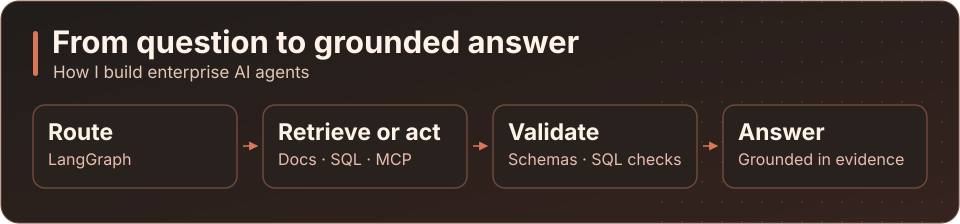

# Krishna Vamsi Dhulipalla

**AI Engineer · Production agent systems, retrieval, and evaluation**

[Portfolio](https://krishna-dhulipalla.github.io/) · [Résumé](https://krishna-dhulipalla.github.io/assets/KrishnaDhulipalla.pdf) · [LinkedIn](https://www.linkedin.com/in/krishnavamsidhulipalla) · [Email](mailto:krishnadhulipalla13@gmail.com)

## About me

I'm an AI engineer based in the San Francisco Bay Area. At Tabner, I build an internal AI platform that helps financial services teams answer questions across databases and documentation without filing a recurring data request. I work on the full request path, from LangGraph orchestration and MCP tools to retrieval, text-to-SQL, FastAPI services, and evaluation before prompt or model changes ship.

That platform automated over **70% of recurring analytics requests**. Model routing, semantic caching, and token controls cut inference costs by **30%**, while structured tool execution, validation, and retries reduced failed agent runs by **40%**.

I earned my **M.S. in Computer Science at Virginia Tech**, where I also worked on genomics machine learning. I built reproducible fine-tuning and evaluation workflows on HPC GPU clusters and contributed to research on DNA foundation models for cross-species transcription factor binding site prediction.

### What I work on

| Area | Tools and methods |
| --- | --- |
| **Agent systems** | Python, LangGraph, MCP, FastAPI, AWS Bedrock |
| **Retrieval and evaluation** | Hybrid search, reranking, RAGAS, LangSmith, offline regression suites |
| **ML and infrastructure** | PyTorch, LoRA, MLflow, Docker, Kubernetes, Go |

## Selected projects

| Project | What it does |
| --- | --- |
| [CoreLink AI](https://github.com/krishna-dhulipalla/CoreLink-AI) | A finance agent that retrieves and validates evidence before using deterministic tools to compute numerical answers. Built with LangGraph, A2A, and MCP and evaluated on OfficeQA. |
| [CoreLink AI Safe](https://github.com/krishna-dhulipalla/corelinkai-safe) | A policy evaluation prototype that checks proposed tool actions against a policy and records evidence for each decision. |
| [AgentTask Operator](https://github.com/krishna-dhulipalla/AgentTask-Operator) | A Go operator for temporary Kubernetes sandboxes with network isolation, execution limits, result capture, and automatic cleanup. |
| [Rounds](https://github.com/krishna-dhulipalla/Clinical-pre-rounding-ai) | A FHIR clinical review prototype that links briefing statements to source records and flags missing evidence. |
| [Vision Incident Response Kit](https://github.com/krishna-dhulipalla/Vision-Incident-Response-Kit--VIRK-) | A toolkit for detecting vision-model drift, identifying affected data slices, and packaging examples for incident analysis. |

## Open source contributions

| Pull request | Status at update | Contribution |
| --- | --- | --- |
| [microsoft/PyRIT #3919](https://github.com/microsoft/PyRIT/pull/3919) | Merged | Deduplicate dataset filters in URL parsing and serialization. |
| [browser-use/browser-use #3677](https://github.com/browser-use/browser-use/pull/3677) | Merged | Fix the async sandbox example so it runs as a standalone script. |
| [niknarra/SE-Project---IntelliMeet #1](https://github.com/niknarra/SE-Project---IntelliMeet/pull/1) | Merged | Update the SMTP server setup. |
| [microsoft/PyRIT #4329](https://github.com/microsoft/PyRIT/pull/4329) | Open | Propose removing the temporary upper bound on the regex dependency. |
| [promptfoo/promptfoo #12433](https://github.com/promptfoo/promptfoo/pull/12433) | Open | Add an IteraCompute example using the generic OpenAI-compatible gateway. |
| [confident-ai/deepeval #2691](https://github.com/confident-ai/deepeval/pull/2691) | Open | Clarify documentation for misuse, MCP use, and tool correctness. |
| [langchain-ai/langgraph #6513](https://github.com/langchain-ai/langgraph/pull/6513) | Open | Correct an async task example and clarify blocking behavior. |
| [NVIDIA-NeMo/Guardrails #1930](https://github.com/NVIDIA-NeMo/Guardrails/pull/1930) | Closed | Update README documentation links. |
| [google/adk-python #3875](https://github.com/google/adk-python/pull/3875) | Closed | Correct `run_async` usage and the `ticketId` payload key in examples. |
| [niknarra/SE-Project---IntelliMeet #10](https://github.com/niknarra/SE-Project---IntelliMeet/pull/10) | Closed | Contribute development UI changes. |

I also filed reports on an [OpenClaw update failure](https://github.com/openclaw/openclaw/issues/182967) and an [Open VSX namespace request](https://github.com/EclipseFdn/open-vsx.org/issues/9272). [All my public PRs](https://github.com/search?q=is%3Apr+author%3Akrishna-dhulipalla&type=pullrequests)

## GitHub activity

